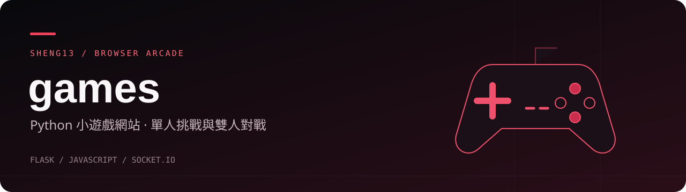

# games · Python 小遊戲網站

以 Flask 提供遊戲大廳，搭配 HTML、CSS、JavaScript 與 Socket.IO 的小遊戲集合。包含單人挑戰、規則式 AI、本機雙人與區域網路房間對戰；遊戲入口集中在 `/`，不需要前端建置流程。

[遊戲與路由](#games) · [安裝啟動](#setup) · [連線玩法](#online) · [選用下載](#download) · [專案地圖](#map) · [測試與限制](#limits)

<a id="games"></a>
## 遊戲與路由

以下功能依 [app.py](app.py)、[online.py](online.py) 與各遊戲頁原始碼整理；檔案連結用於閱讀程式，實際遊玩請先啟動 Flask，再使用路由。

| 路由 | 原始碼 | 內容 |
|---|---|---|
| `/` | [games.html](games.html) | 遊戲大廳 |
| `/guess` | [guess.html](guess.html) | 猜數字；簡單、普通、困難三檔，後端回傳大小提示與剩餘次數 |
| `/gomoku` | [index.html](index.html) | 五子棋；三檔 AI、本機雙人、計時、歷史棋盤與回放 |
| `/tictactoe` | [tictactoe.html](tictactoe.html) | 三子移動井字棋；三檔 AI、本機雙人，每方放滿三子後移動 |
| `/snake` | [snake.html](snake.html) | 霓虹貪吃蛇；鍵盤、觸控、速度選擇、暫停與本機最高分 |
| `/2048` | [2048.html](2048.html) | 霓虹 2048；鍵盤、滑動、撤銷一步與本機最高分 |
| `/chess` | [chess.html](chess.html) | 西洋棋；三檔 AI、本機雙人、合法走法提示與升變選擇 |
| `/tetris` | [tetris.html](tetris.html) | 霓虹俄羅斯方塊；暫存、下一個方塊、落地預測與消行積分 |
| `/breakout` | [breakout.html](breakout.html) | 霓虹打磚塊；碰撞、強化道具與多關卡 |
| `/minesweeper` | [minesweeper.html](minesweeper.html) | 霓虹踩地雷；三檔難度、展開與行動裝置插旗模式 |
| `/online` | [online.html](online.html) | 五子棋、三子移動井字棋、西洋棋的雙人房間 |
| `/luxfatum/download` | [app.py](app.py) | 選用安裝包下載；未設定或檔案不存在時回傳 404 |

注意：根目錄的 `index.html` 是五子棋，Flask 的首頁 `/` 則提供 `games.html`。直接使用靜態伺服器不會提供猜數字 API、Socket.IO 或下載功能。

<a id="setup"></a>
## 安裝啟動

準備 Python 3 與 `uv`，在儲存庫根目錄建立隔離環境：

```bash
uv venv .venv
uv pip install --python .venv/bin/python -r requirements.txt
.venv/bin/python app.py
```

本機開啟 `http://127.0.0.1:8000/`，從大廳選擇遊戲；按 `Ctrl+C` 停止。依賴見 [requirements.txt](requirements.txt)：Flask、Flask-SocketIO 與 gunicorn；不需要 npm 安裝。

程式預設監聽 `0.0.0.0:8000` 並開啟 `debug=True`，只適合受控的開發環境，不能直接暴露到公網。同一區域網路的設備可使用 `http://伺服器區網IP:8000/`；防火牆須允許 TCP 8000。虛擬機還需確認橋接或轉送設定，不能只把 `127.0.0.1` 分享給另一台設備。

`SECRET_KEY` 可由程序環境設定，未設定時會隨程序產生隨機值；重新啟動可能讓既有猜數字 session 失效。程式不會自動讀取 `.env`，請勿把真實金鑰放進文件或儲存庫。

<a id="online"></a>
## 連線玩法

1. 兩台設備連上同一區域網路，開啟同一台伺服器的 `/online`。
2. 第一位玩家選擇五子棋、井字棋或西洋棋，建立房間。
3. 將六位數房間代碼交給第二位玩家，第二位輸入代碼加入。
4. 維持雙方頁面連線；任一玩家中斷連線，伺服器就會結束該房間。

聯機落子由 `online.py` 檢查回合與合法性，西洋棋包含將軍判定、王車易位、吃過路兵與升變處理。房間只存在單一 Python 程序的記憶體中，重啟不會保留；沒有斷線續局或跨程序共用機制。

<a id="download"></a>
## 選用：LuxFatum 安裝包

大廳保留下載入口，但儲存庫不附真實安裝包。未設定下載檔案時只會讓 `/luxfatum/download` 回傳 404，不影響其他遊戲。

若你已另行準備具有散布權的安裝包，可在啟動前指定路徑：

```bash
export LUXFATUM_INSTALLER="releases/LuxFatum-Setup.exe"
.venv/bin/python app.py
```

相對路徑以 `app.py` 所在目錄為準，也接受絕對路徑與 `~`。上例只是設定範例，不會產生或下載安裝包；請把大型交付物、版本與發布權限分開管理。

<a id="map"></a>
## 專案地圖

```text
.
├── app.py                      # 頁面路由、猜數字 API、選用下載
├── online.py                   # Socket.IO 房間與伺服器端棋類規則
├── games.html                  # 大廳；其餘遊戲頁見路由表
├── static/socket.io.min.js     # 隨附瀏覽器端 Socket.IO
├── requirements.txt            # Python 依賴
├── tests/                      # 下載、頁面及遊戲邏輯測試
│   └── fixtures/               # 微型文字下載樣本，不是真實安裝包
├── CODE_WALKTHROUGH.md          # 既有程式導讀
├── tools/                      # 簡報產生工具
├── README.md
└── docs/readme-banner.svg
```

若要新增遊戲，需同時調整 HTML 頁面、`app.py` 路由與 `games.html` 大廳；聯機遊戲另需在 `online.py` 實作伺服器端狀態與規則。[既有程式導讀](CODE_WALKTHROUGH.md) 可作為輔助閱讀，實際行為仍以原始碼為準。

<a id="limits"></a>
## 測試與限制

在已安裝依賴的環境，可從根目錄執行既有測試：

```bash
.venv/bin/python -B -W error::ResourceWarning -m unittest discover -s tests -v
```

[test_luxfatum.py](tests/test_luxfatum.py) 檢查頁面回應、猜數字初始化與下載設定，使用隨附文字樣本。[test_gameplay.py](tests/test_gameplay.py) 透過 Node.js 檢查俄羅斯方塊暫存及貪吃蛇邏輯；若沒有 Node.js，這部分會標示跳過，不需 npm 套件。JavaScript 測試以替代 UI／計時器執行邏輯，不等於完整瀏覽器操作測試。

- 本次文件整理未安裝套件、執行遊戲或重跑測試，沒有宣稱測試已通過。
- 多款遊戲把最高分保存在瀏覽器 `localStorage`；不會同步到其他裝置，清除網站資料後可能遺失。
- 這是學習與休閒專案，沒有正式帳號、競賽防作弊或持久化房間機制；Socket.IO 設定接受所有來源，公開部署前需另作安全設計。
- 棋類 AI 是程式內的規則與搜尋邏輯，不會呼叫外部大型語言模型，也不代表專業棋力或完整賽事規則認證。
- 各遊戲與第三方程式庫名稱、商標屬其權利人；隨附 Socket.IO 的授權請保留原始檔標示。根目錄未附專案授權檔，對外重用程式、素材或安裝包前請先確認權利。

頁首紅黑 SVG 是標題裝飾，不是遊戲截圖。此文件只描述目前原始碼，沒有修改既有程式、CI 設定或部署服務。
